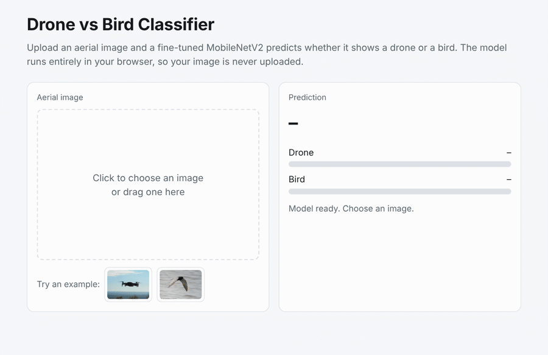

<h1 align="center"> Drone vs Bird: Aerial Object Classification</h1>

<b>Deep learning model that tells drones from birds in aerial images, with a live demo that runs in your browser</b>

  

  

---

## 📁 Project Overview

Drones and birds look alike at a distance, which makes aerial surveillance systems prone to false alarms. This project compares four deep learning models for classifying an aerial image as a **Drone** or a **Bird**, and deploys the best one as a web demo.

---

## 🧪 Dataset

- [Drone vs Bird dataset](https://www.kaggle.com/datasets/muhammadsaoodsarwar/drone-vs-bird) on Kaggle: 4,106 images (2,499 drone, 1,607 bird)
- Stratified split: 70% train, 15% validation, 15% test

---

## 📌 Tools Used

- Python, TensorFlow and Keras, scikit-learn
- ONNX Runtime Web (browser demo)
- Google Colab (T4 GPU)

---

## 🔬 Workflow

1. **Preprocessing:** resized images to 224×224, augmented the training set, and used class weights for the imbalance.
2. **Modeling:** trained a Custom CNN and three transfer learning models (MobileNetV2, ResNet50, VGG16), then fine-tuned MobileNetV2.
3. **Evaluation:** selected the best model on the validation set and tested it once on unseen images.
4. **Deployment:** exported the model to ONNX so it runs directly in the browser.

---

## 📈 Results

| Model | Test accuracy | Macro F1 |
|---|---|---|
| **MobileNetV2 (fine-tuned)** | **99.0%** | **99.0%** |
| ResNet50 | 99.4% | 99.3% |
| VGG16 | 97.6% | 97.5% |
| MobileNetV2 | 97.2% | 97.1% |
| Custom CNN | 93.8% | 93.6% |

- 📌 Transfer learning beat the Custom CNN on every metric.
- 📌 Fine-tuned MobileNetV2 was chosen for the demo: best on validation and about 7 times smaller than ResNet50.
- 📌 A data leakage check found duplicate frames in the dataset. On test images with no near-duplicate in training, accuracy stayed at **98.3%**.

Full analysis, confusion matrices, and error analysis are in the [notebook](notebooks/Drone_vs_Bird_Classification.ipynb).

---

## 🧠 Conclusion

Pre-trained, lightweight models classify drones and birds very reliably, even with a small dataset. MobileNetV2 is also designed for limited hardware, which suits drone-detection systems running on edge devices.

**Limitations and next steps:** many images in the dataset are near-identical video frames, so a larger and more varied dataset would give a stronger test. Next steps include grouping frames by video before splitting and testing on footage from new environments.

---

## 👩‍💻 Team

- Ghada Alqahtani        - Layan Murayshid
- Shahad Alotaibi        - Raghad Al-Qwaider        

Course: **IT 461 - Machine Learning**, King Saud University.

